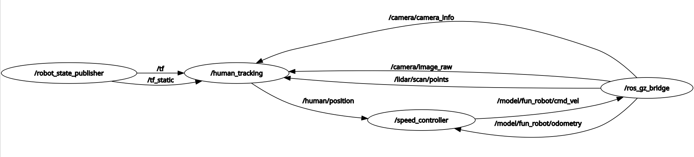
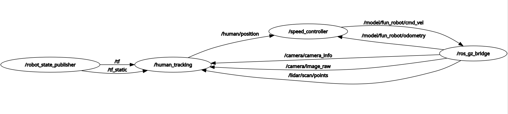

# робот-проводник

## что это за робот куда он вообще едет

хочется, чтобы человек мог идти в своем темпе, пока робот ведет его до нужного места. в gazebo я реализовала этот кусок на прямом участке. робот едет впереди, **подстраивает скорость под шаг человека** и тормозит, когда тот останавливается.

в моей реализации целевая дистанция составляет **около двух метров**. для реального робота ее нужно подкоррекировать с учетом исследований о том, на каком расстоянии человеку комфортно идти за роботом.

в работе про сопровождение человека авторы разбирают похожую задачу: робот должен замечать, что человек идет за ним, отстает или остановился, и менять ход. [online human action detection during escorting](https://arxiv.org/abs/2506.23573)

[исследование дистанции при ходьбе за роботом-проводником](https://www.jstage.jst.go.jp/article/aija/75/652/75_652_1399/_article/-char/en)

## камера и поворты

на реалньом роботе будет **одна широкоуглольная камера сзади по центру**. широкий угол обзора поможет видеть чела, когда он идет чуть сбоку или когда робот поворачивает.

**пока сценраий рассчитан на движение по прямой.** повороты робота и человека еще не реализованы. на повортое робот должен подстроить скорсоть под шаг человека, чтобы тот успевал за ним.

[пособие ИТМО: датчики в симуляции и на реальном роботе, § 1.14](https://books.ifmo.ru/file/pdf/3568.pdf#page=25)

## а че тут две схемы куда смотреть

тут один и тот же граф, просто узлы по разному разложены. на первой картнке показао откуда берется положение челвоека. на второй видно, куда потом уходит команда скорости.

### схема 1. как понять, где челоек находится?



есть такая штука, называется **yolo**. это модель, которая смотрит на кадр с камеры, находит чела и обводит его рамкой. по рамке видно, в какой части картинки он находится.

а как узнать, сколько до него метров? тут помогает **3d-лидар**. он выдает облако точек - набор точек с координатами в пространстве.

программа накладвает их на картинку и берет те, что попали в рамку. так можно понять, что чел, например, в двух метрах позади и чуть справа.

[YOLO11n: документация на русском](https://docs.ultralytics.com/ru/models/yolo11/) · [пособие ИТМО: камера, лидар и обработка данных, глава 8](https://books.ifmo.ru/file/pdf/3568.pdf#page=98)

### схема 2. окей, челвоека нашли, а с какой скорстью то ехать?



робот смотрит, как быстро идет человек и какой между ними зазор. допустим, человек отстал на три метра. робот сбавит ход, чтобы дать ему догнать себя. комнада уходит в gazebo, и там робот меняет скорсоть.

[пособие ИТМО: простой регулятор, § 3.4](https://books.ifmo.ru/file/pdf/3568.pdf#page=42) · [как читать граф ROS 2, § 2.4](https://books.ifmo.ru/file/pdf/3568.pdf#page=33)

| топик | что по нему передается |
| --- | --- |
| `/camera/image_raw` | картинка с задней камеры. yolo ищет на ней человека |
| `/camera/camera_info` | настройки камеры. по ним программа понимает, куда на картинке попадет каждая точка лидара |
| `/lidar/scan/points` | точки, которые измерил лидар. у каждой есть координаты в пространстве |
| `/tf`, `/tf_static` | данные о том, где находятся и куда смотрят камера, лидар и другие части робота |
| `/human/position` | где человек находится относительно робота и когда это измерили. регулятор берет эти данные, чтобы выбрать скорость |
| `/model/fun_robot/odometry` | где сейчас сам робот и с какой скоростью он едет |
| `/model/fun_robot/cmd_vel` | команда от регулятора: с какой скоростью робот должен ехать в симуляции |
| `/speed_controller/ready` | сигнал о том, что регулятор уже получает данные. после него человек в симуляции начинает идти |
| `/clock` | часы gazebo. по ним все части программы понимают, сколько времени прошло в симуляции |

[пособие ИТМО: узлы, топики и сообщения, §§ 1.3–1.4](https://books.ifmo.ru/file/pdf/3568.pdf#page=12)

## причем тут фильтр калмана и что это такоее вообще

вот чел стоит на месте, а точки лидара все равно чуть прыгают. если взять два замера и посчитать скорость по разнице коордиант, может показаться, что он идет. фильтр калмана помогает получить более ровную оценку скорости.

### а что он там считает вообще?

фильтр хранит пололжение и скорсоть. сначала прикидывает, куда человек успеет дойти в том же темпе. потом сверяет прогноз с новым замером.

```text
прогноз положения = прошлое положение + скорость × время между замерами
разница = новое измерение положения − прогноз положения

новое положение = прогноз положения + K₁ × разница
новая скорость  = прежняя скорость  + K₂ × разница
```

`K₁` и `K₂` показывают, насколько сильно замер меняет пололжение и скорсоть. фильтр сам рассчитывает их с учетом шума измернеий и уверенности в прогнозе.

**пример.** фильтр ожидал, что человек будет на отметке 3,0 м, а замер показал 3,2 м. разница - 0,2 м. при `K₁ = 0,5` фильтр сдвинет оценку положнеия на 0,1 м и получит 3,1 м. по той же разнице он немного поправит оценку скорости.

при резкой остановке такая оценка может запаздывать. поэтому регулятор еще проверяет свежие замреы, чтобы начать тормозить раньше.

в [speed_controller.py](speed_controller.py) я использую фильтр, который хранит две величины: положение человека и его скорость. на вход подаю оценку положения по лидару и одометрии робота. по времени между замерами фильтр прикидывает, куда человек успел дойти, а следующий замер помогает поправить и положение, и скорость.

расчеты записаны в классе `KalmanFilter1D`. эту же модель можно посмотреть на [примере с кодом на python в документации FilterPy](https://filterpy.readthedocs.io/en/latest/kalman/KalmanFilter.html).

[фильтр калмана: от простого к сложному (хабр)](https://habr.com/ru/articles/991860/)

## запуск проекта

### 1. скачай проект и установи программы

1. на странице репозитория нажми **Code → Download ZIP** и распакуй архив.
2. открой распакованную папку в VS Code. в меню выбери **Терминал → Создать терминал**. все команды ниже вводи в этом терминале. [установка VS Code](https://code.visualstudio.com/docs/setup/linux)
3. установи ROS 2 Jazzy по инструкции для Ubuntu 24.04. ROS 2 передает данные между частями проекта, а Gazebo показывает, как робот и человек двигаются в симуляции. [скачать Ubuntu 24.04](https://releases.ubuntu.com/noble/) · [установить ROS 2 Jazzy](https://docs.ros.org/en/jazzy/Installation/Ubuntu-Install-Debs.html)

после установки ROS 2 введи команды ниже. они установят Gazebo, связь между ним и ROS 2, а также пакеты, которые нужны проекту. [инструкция Gazebo](https://gazebosim.org/docs/latest/ros_installation/)

```bash
sudo apt update
sudo apt install python3-venv ros-jazzy-ros-gz ros-jazzy-robot-state-publisher \
  ros-jazzy-xacro ros-jazzy-sensor-msgs-py ros-jazzy-tf2-sensor-msgs \
  ros-jazzy-gz-transport-vendor ros-jazzy-gz-msgs-vendor
```

[пособие ИТМО: подготовка Ubuntu и первый запуск ROS 2, §§ 2.1–2.3](https://books.ifmo.ru/file/pdf/3568.pdf#page=28)

### 2. создай окружение и установи YOLO

`yolo_venv` - отдельная папка с Python и библиотеками проекта. команды сами создадут ее и установят туда YOLO. этот шаг нужен один раз после скачивания проекта. [что такое venv](https://docs.python.org/3.12/library/venv.html) · [установка Ultralytics](https://docs.ultralytics.com/ru/quickstart/)

```bash
source /opt/ros/jazzy/setup.bash
python3 -m venv --system-site-packages yolo_venv
./yolo_venv/bin/python -m pip install 'numpy<2' 'opencv-python<4.12' ultralytics
```

первая команда подключает ROS 2, вторая создает папку `yolo_venv`, третья скачивает библиотеки. файл `yolo11n.pt` уже лежит в проекте. в нем хранятся веса модели, которая ищет человека на картинке с камеры. [документация YOLO11n](https://docs.ultralytics.com/ru/models/yolo11/)

### 3. скачай модель человека для симуляции

**Standing Person** - это 3d-модель человека, которого робот будет видеть в Gazebo. выполни команду ниже один раз. Gazebo сам сохранит модель в нужную папку. [модель Standing Person](https://fuel.gazebosim.org/1.0/OpenRobotics/models/Standing%20Person) · [как скачивать модели из Gazebo Fuel](https://gazebosim.org/docs/harmonic/fuel_insert/)

```bash
gz fuel download --force-version 3 -u 'https://fuel.gazebosim.org/1.0/OpenRobotics/models/Standing%20Person'
```

### 4. запусти симуляцию

скопируй обе команды в терминал. первая подключает ROS 2, вторая запускает симуляцию и YOLO вместе.

```bash
source /opt/ros/jazzy/setup.bash
ros2 launch ./speed_adaptation.launch.py
```

дождись окна задней камеры. вокруг человека появится рамка, а рядом будет показано расстояние. человек сначала идет медленно, потом быстрее и в конце останавливается. робот подстраивает скорость под его шаг.

симуляцию можно остановить сочетанием клавиш **Ctrl+C** в терминале.

[пособие ИТМО: запуск узлов одной командой, § 3.5](https://books.ifmo.ru/file/pdf/3568.pdf#page=45)
